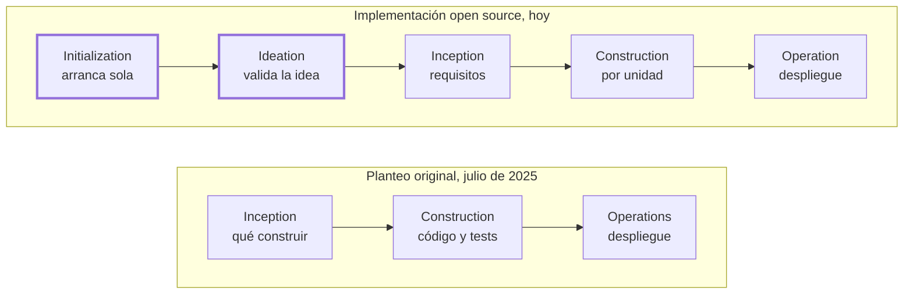

No, los sprints no se terminaron. Pero hay un método nuevo que los reemplaza por ciclos de horas, y vale la pena entender por qué.

## Un ritmo pensado para personas

Scrum y el resto de los marcos ágiles se diseñaron para equipos donde una persona escribe cada línea de código. Dos semanas de sprint tienen sentido cuando planificar, programar y revisar lleva días.

Con agentes de IA que generan código, tests y documentación en minutos, ese ritmo empieza a quedar largo. Muchos equipos usan IA y mantienen el mismo proceso: mismos sprints, mismas ceremonias, mismas revisiones de PR días después. AI-DLC propone **cambiar el proceso, no solo la herramienta**.

## Qué es AI-DLC

AI-DLC (AI-Driven Development Life Cycle) es un ciclo de desarrollo donde la IA hace el trabajo de producción y las personas toman las decisiones. Lo presentó Raja SP, arquitecto de soluciones en AWS, en el [blog de DevOps de AWS](https://aws.amazon.com/blogs/devops/ai-driven-development-life-cycle) el 31 de julio de 2025.

La idea central es una inversión. Hoy, en la mayoría de los equipos, la persona arranca la conversación: escribe un prompt, la IA ayuda con una tarea y el resultado entra al proceso de siempre. En AI-DLC arranca la IA:

1. Recibe una intención de negocio.
2. La convierte en un plan y hace preguntas sobre los casos borde, las integraciones y las reglas que nadie escribió.
3. Se frena antes de cada paso importante y espera la aprobación de una persona.
4. Recién con esa aprobación genera código y tests.

La persona no sale del ciclo: se mueve a las compuertas de aprobación. El argumento de fondo es que la IA no tiene el contexto de negocio, y por eso las decisiones críticas siguen siendo humanas.

## El vocabulario nuevo, frente a Agile

AI-DLC renombra las piezas de Agile a propósito: cuando la IA redacta planes, código y tests en segundos, conviene trabajar en lotes más chicos.

| Agile | AI-DLC | Qué cambia |
| --- | --- | --- |
| Sprint de 2 semanas | Bolt | Ciclos de horas o días |
| Épica | Unidad de trabajo | Bloques más chicos, con límites claros entre sí |
| Refinamiento del backlog | Mob Elaboration | Todo el equipo responde en vivo las preguntas de la IA y aprueba los requisitos |
| Revisión de PR asíncrona | Mob Construction | El equipo valida arquitectura, código y tests en el momento, no días después |
| Decisiones repartidas en la ejecución | Compuertas de aprobación | Las decisiones humanas se concentran antes de cada paso importante |

**Renombrar no alcanza por sí solo.** Si el equipo llama bolt al sprint y sigue trabajando igual, no cambió nada.

## Las fases: de tres a cinco

El planteo original de 2025 tiene tres fases: Inception define qué construir, Construction lo construye y Operations lo pone en producción. La [implementación open source](https://awslabs.github.io/aidlc-workflows/guide/04-phases-and-stages/) mantiene esas tres y suma dos al principio.

Initialization prepara el espacio de trabajo y es la única fase sin aprobaciones. Ideation valida la iniciativa antes de gastar esfuerzo: factibilidad, alcance y equipo. En total son 33 etapas, pero casi nunca se corren todas: un prototipo rápido saltea casi toda Ideation y no llega a Operation, mientras que una funcionalidad completa las corre todas.

## Un bolt, paso a paso

Este ejemplo es ilustrativo: no sale de un proyecto real, sirve para ver cómo encajan las piezas. La tarea es sumar recuperación de contraseña por mail a una app que ya tiene login.

1. Intención: El equipo la escribe concreta: qué se quiere, qué queda afuera (por ejemplo, el login con redes sociales) y cuándo está terminado.
2. Preguntas de la IA: Antes de planificar, pregunta lo que falta: cuánto dura el link, qué pasa si el mail no existe, si hay límite de intentos.
3. Mob Elaboration: Producto, desarrollo y seguridad responden juntos y aprueban los requisitos. Sale un plan con dos unidades de trabajo: el envío del link y el cambio de contraseña.
4. Aprobación del plan: Una persona que no escribió la intención revisa el plan de cada unidad y lo aprueba o pide cambios.
5. Construcción por unidad: La IA propone el diseño, genera código y tests, y se frena en un punto de control por unidad. El equipo valida en el momento.
6. Cierre del bolt: Con las dos unidades aprobadas, la IA prepara el despliegue y el equipo lo aprueba.

**El punto clave está en los pasos 2 y 4.** Ahí es donde el criterio humano cambia el resultado.

## Entonces, ¿se terminaron los sprints?

No del todo. Mi lectura es que AI-DLC cambia los rituales de Agile, no sus valores: iterar en ciclos cortos y validar con personas sigue en el centro. Lo que se mueve es dónde se pone el criterio humano, menos en escribir y más en aprobar.

Y ahí aparecen los límites que conviene tener en cuenta:

- Las aprobaciones se vuelven automáticas. Quienes lo implementaron cuentan que, después de un rato leyendo documentos generados, aprobar deja de ser una decisión real. Una aprobación de compromiso es peor que ninguna, porque deja un registro que dice que alguien revisó.
- El que pide es el que aprueba. Si la misma persona escribe la intención y aprueba el plan, se pierde el control cruzado. La herramienta registra quién aprobó, pero no decide quién debería hacerlo.
- Los cambios chicos pagan de más. Un bug menor puede frenar varias veces en compuertas. Hay perfiles livianos para eso, pero hay que elegirlos bien.
- Las cifras son de AWS. Las mejoras de productividad que se presentaron vienen de proyectos con ingenieros de AWS presentes, muchas veces desde cero. No hay mediciones independientes todavía.
- Los proyectos grandes siguen costando. Un código grande sigue llenando el contexto de los agentes, y la gobernanza suma trabajo que un equipo chico puede no tener tiempo de sostener.

Por eso, para mí, **el método funciona tan bien como las aprobaciones que lo sostienen**: si aprobar se vuelve un clic, todo lo demás pierde sentido.

## Para quién tiene sentido y cómo probarlo

AI-DLC encaja mejor en equipos que ya usan agentes de IA y saben escribir especificaciones claras. Si un pedido no se puede explicar con precisión, la IA no tiene de dónde sacar el plan.

Para probarlo sin riesgo:

1. Medir antes: cuánto tarda hoy un cambio en llegar a producción y cuántos errores se escapan.
2. Elegir un repositorio chico y una tarea de bajo riesgo, como un bug menor.
3. Correr un bolt completo con la [implementación open source](https://github.com/awslabs/aidlc-workflows) y contar cuántas compuertas aparecen.
4. Definir quién aprueba antes de escalar, y que no sea quien escribió el pedido.

Al final, la pregunta que me parece útil no es si AI-DLC mata a Agile. Es si tu equipo está listo para **aprobar bien**, que es mucho más difícil de lo que parece.

## Fuentes

- Raja SP, [AI-Driven Development Life Cycle: Reimagining Software Engineering](https://aws.amazon.com/blogs/devops/ai-driven-development-life-cycle), AWS DevOps Blog, julio de 2025
- [AI-DLC Workflows: Phases and Stages](https://awslabs.github.io/aidlc-workflows/guide/04-phases-and-stages/), documentación oficial
- [awslabs/aidlc-workflows](https://github.com/awslabs/aidlc-workflows), repositorio en GitHub
- [AI-DLC in Practice: Running AWS's AI-Driven Lifecycle](https://orchestrator.dev/blog/2026-10-03-ai-dlc-in-practice/), orchestrator.dev, octubre de 2026
