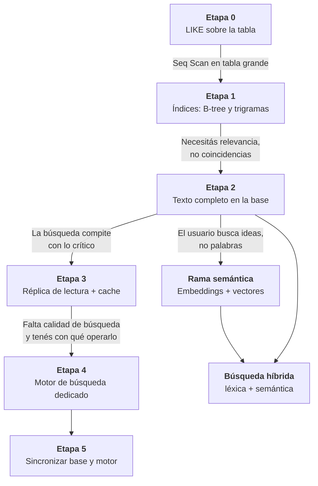
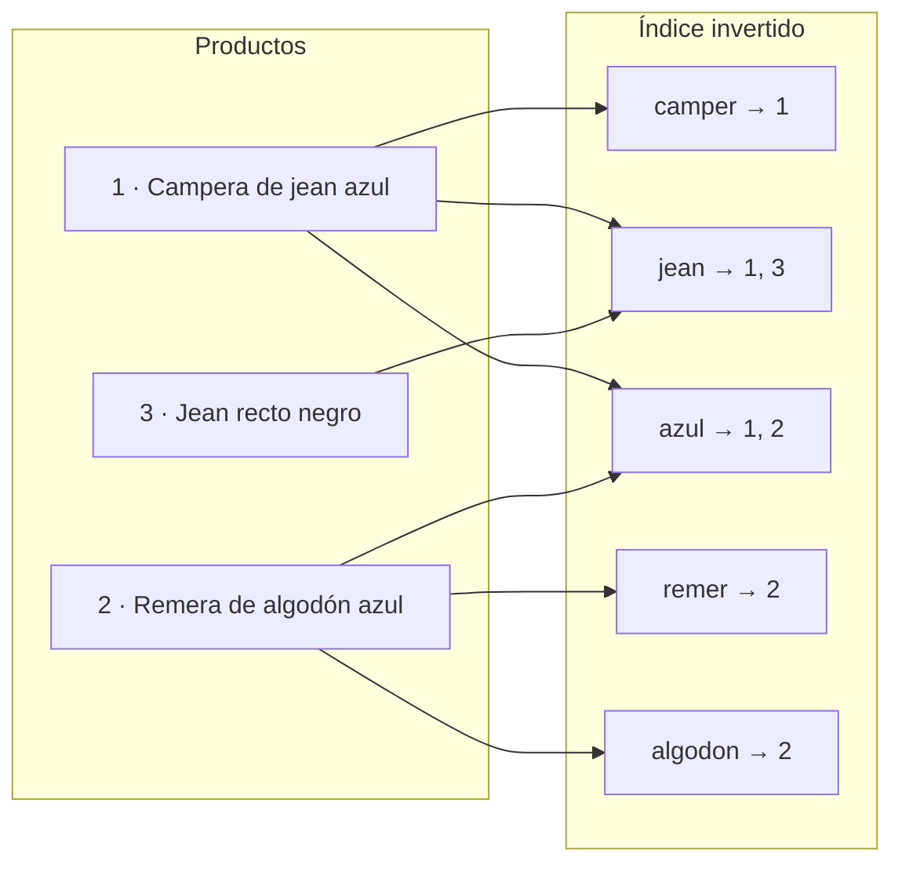
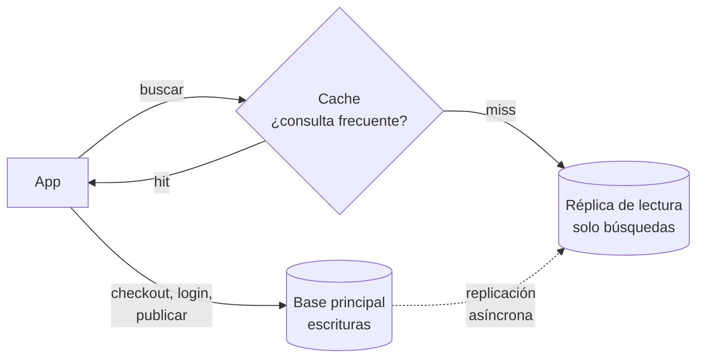
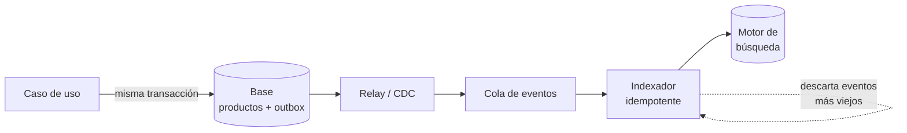
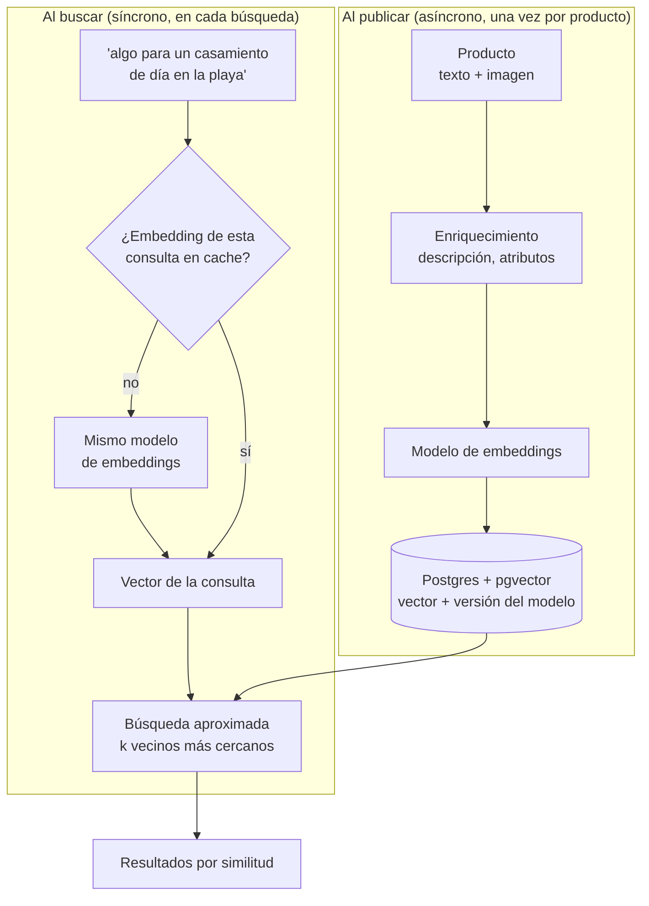
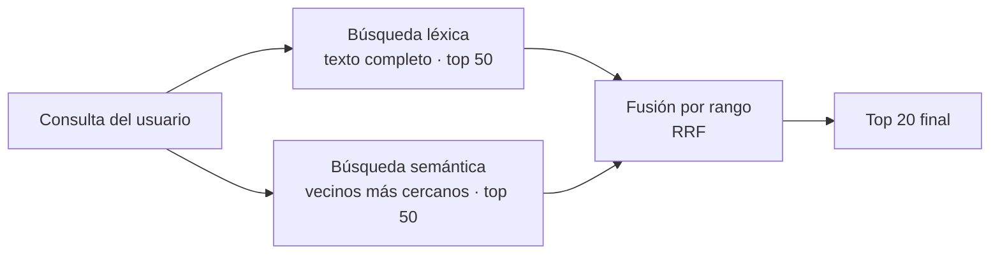
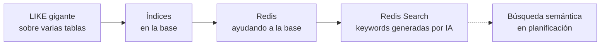
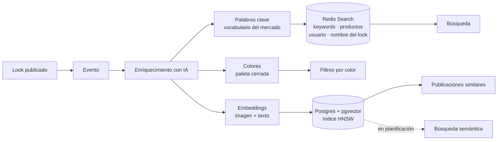

La primera versión del buscador de Branded era un `LIKE` gigante. Una sola consulta que cruzaba varias tablas y evaluaba el texto contra cada una, en cada búsqueda. Y funcionaba: con poco contenido respondía rápido, y no había nada más que mantener.

Hoy esa misma caja de búsqueda corre sobre un índice en Redis, alimentado por palabras clave que genera un modelo de IA. En el medio hubo índices en la base, y un Redis que entró primero para ayudarla.

Una caja de búsqueda parece la feature más simple de un producto. Un input, un botón, una lista de resultados. Y sin embargo es de las pocas piezas que te acompañan desde el primer día hasta el último, cambiando de forma por completo varias veces en el camino.

Lo que me interesa de ese recorrido no es la foto final. Es **por qué** se pasa de una etapa a la siguiente, qué señal te avisa que llegó el momento, y cuánto cuesta cada salto. Porque la tentación más común no es quedarse corto: es arrancar por el final, con un motor de búsqueda dedicado el primer día, para un catálogo de trescientos productos, mantenido por un equipo de dos.

Voy a recorrerlo etapa por etapa, con la regla que uso para todo: **cada pieza nueva entra cuando hay un dolor concreto y medible**. Para los ejemplos uso ropa, porque es el mundo en el que trabajo todos los días en Branded. Y al final vuelvo a Branded, para mostrar dónde cae cada uno de nuestros pasos en ese mapa.

Este es el mapa completo. No es una escalera que hay que subir entera: es un mapa de opciones, y la mayoría de los productos se quedan a mitad de camino, que es exactamente donde tienen que quedarse.



## Etapa 0: el LIKE que funciona

Tenés una tabla de productos y una caja de texto. La primera versión del buscador es esto:

```sql
SELECT id, nombre, precio
FROM productos
WHERE nombre ILIKE '%campera%';
```

Y está bien. En serio. Con poco catálogo y pocos usuarios, responde al instante, no tenés nada nuevo que aprender ni que mantener, y podés dedicar la energía a lo que de verdad no sabés todavía: si alguien quiere tu producto.

Lo que pasa por debajo es que la base lee **todas** las filas, una por una, y se fija si el nombre contiene la cadena. Es un recorrido secuencial (*sequential scan*). El costo crece en línea recta con el tamaño de la tabla:

$$
T_{\text{búsqueda}} \propto N \quad\Rightarrow\quad T_{\text{total}} \propto N \cdot Q
$$

donde $N$ es la cantidad de productos y $Q$ la cantidad de búsquedas por segundo. Con mil productos no lo notás. Con un millón, cada búsqueda es leer un millón de filas, y cada usuario que busca lo vuelve a hacer. Lo que mata no es una búsqueda lenta: es el producto $N \cdot Q$, porque las dos cosas crecen juntas cuando el producto anda bien.

La señal de que esta etapa se terminó no es una intuición. Es esto:

```sql
EXPLAIN ANALYZE
SELECT id FROM productos WHERE nombre ILIKE '%campera%';

-- Seq Scan on productos  (actual time=0.031..412.507 rows=1830 loops=1)
--   Filter: (nombre ~~* '%campera%'::text)
--   Rows Removed by Filter: 998170
```

Ese `Rows Removed by Filter` es la cantidad de trabajo que hiciste para nada. Cuando ese número es varios órdenes de magnitud más grande que las filas que devolviste, y la latencia acompaña, la etapa 0 cumplió su ciclo.

## Etapa 1: un índice (y por qué el primero no alcanza)

La respuesta de manual es "poné un índice". Un índice B-tree es la información preordenada, como un diccionario: si buscás "campera", no leés el diccionario entero, vas directo a la C. El costo pasa de lineal a logarítmico, $O(\log N)$, que en la práctica es la diferencia entre leer un millón de filas y leer unas veinte páginas.

El problema es que el diccionario te sirve si conocés **el principio** de la palabra. `LIKE 'camp%'` lo puede usar. `LIKE '%campera%'` no, porque el comodín del principio dice "puede empezar con cualquier cosa", y un diccionario ordenado por la primera letra no te ayuda a encontrar palabras que *contienen* algo en el medio. Y "campera de jean" contiene "campera" al principio, pero "jean" está en el medio.

> Un detalle de Postgres que muerde a más de uno: para que un B-tree sirva incluso con el prefijo, si tu base no usa la collation `C` el índice tiene que crearse con `text_pattern_ops`. Si no, el planner lo ignora y seguís en `Seq Scan` sin enterarte.

```sql
CREATE INDEX productos_nombre_prefijo ON productos (nombre text_pattern_ops);
```

Para el `%algo%` existe otra herramienta, menos conocida: los **trigramas**. La idea es partir cada texto en todos sus pedazos de tres letras e indexar esos pedazos:

```
"jean" → {"  j", " je", "jea", "ean", "an "}
```

Buscar "%jean%" pasa a ser "dame las filas que tengan *todos* estos trigramas", y eso sí se resuelve con un índice invertido (GIN), sin importar en qué parte del texto esté la palabra.

```sql
CREATE EXTENSION IF NOT EXISTS pg_trgm;
CREATE INDEX productos_nombre_trgm ON productos USING gin (nombre gin_trgm_ops);
```

Con eso, el mismo `ILIKE '%jean%'` usa índice. Y de regalo te da algo que se suele atribuir solo a un motor dedicado: tolerancia a errores de tipeo. Dos palabras que comparten la mayoría de sus trigramas son parecidas, y Postgres te deja medirlo:

$$
\text{similitud}(a, b) = \frac{|\,T(a) \cap T(b)\,|}{|\,T(a) \cup T(b)\,|}
$$

```sql
SELECT nombre, similarity(nombre, 'canpera') AS sim
FROM productos
WHERE nombre % 'canpera'          -- usa el índice; umbral por defecto 0.3
ORDER BY sim DESC
LIMIT 10;                          -- encuentra "campera"
```

Dos límites que conviene tener claros. Con búsquedas de menos de tres letras, los trigramas casi no filtran y el índice deja de ayudar. Y seguís buscando **cadenas**: "remera" no encuentra "remeras" de forma confiable, y "campera jean" no encuentra "campera de jean azul" en el orden que esperarías. No hay noción de palabra, ni de relevancia.

## Etapa 2: buscar palabras, no cadenas

El siguiente salto es conceptual. Dejás de preguntar "¿este texto contiene estos caracteres?" y empezás a preguntar "¿este producto **habla** de estas palabras?, ¿y cuánto?".

Eso es la búsqueda de texto completo (*full text search*). Por dentro es otra vez un índice invertido, pero de palabras: en lugar de guardar "fila → texto", guarda "palabra → filas donde aparece".



Buscar "jean azul" pasa a ser cruzar dos listas cortas: `{1, 3} ∩ {1, 2} = {1}`. No leés la tabla, leés dos renglones de un índice.

Fijate que en el índice no dice "campera" ni "remera": dice "camper" y "remer". Antes de indexar, el texto pasa por un **analizador** que lo normaliza: separa en palabras, pasa a minúsculas, descarta palabras vacías ("de", "la", "con") y reduce cada palabra a su raíz según el idioma (*stemming*). Así "remera", "remeras" y "remerita" terminan en el mismo lugar, y la búsqueda deja de depender de cómo lo escribió cada uno.

En Postgres lo tenés sin instalar nada. Hay un detalle que conviene resolver desde el día uno: la configuración `spanish` no saca los acentos, entonces "algodón" y "algodon" son palabras distintas. Lo arreglás armando tu propia configuración:

```sql
CREATE EXTENSION IF NOT EXISTS unaccent;

CREATE TEXT SEARCH CONFIGURATION es_sin_acentos (COPY = spanish);
ALTER TEXT SEARCH CONFIGURATION es_sin_acentos
  ALTER MAPPING FOR hword, hword_part, word
  WITH unaccent, spanish_stem;
```

Y después guardás el texto ya analizado en una columna, con **pesos**: que la palabra aparezca en el nombre vale más que si aparece en la descripción.

```sql
ALTER TABLE productos ADD COLUMN busqueda tsvector
  GENERATED ALWAYS AS (
       setweight(to_tsvector('es_sin_acentos', nombre), 'A')
    || setweight(to_tsvector('es_sin_acentos', coalesce(descripcion, '')), 'B')
  ) STORED;

CREATE INDEX productos_busqueda ON productos USING gin (busqueda);

SELECT nombre, ts_rank(busqueda, q) AS relevancia
FROM productos, websearch_to_tsquery('es_sin_acentos', 'campera jean') q
WHERE busqueda @@ q
ORDER BY relevancia DESC
LIMIT 20;
```

`websearch_to_tsquery` entiende la sintaxis que la gente ya escribe en cualquier buscador: comillas para frases, un guion para excluir (`campera -cuero`), `or` para alternativas. Y para el autocompletado básico, el prefijo: `to_tsquery('es_sin_acentos', 'camp:*')` encuentra todo lo que empiece con "camp".

**Lo que ganaste en esta etapa no es "encontrar": es ordenar por relevancia.** El resultado que más tiene que ver con lo que escribiste aparece primero. Para muchísimos productos, este es el último paso del lado léxico que van a necesitar en años. Y ojo con un límite de `ts_rank` que retomo más adelante: mide cuántas veces aparece la palabra en *ese* documento, pero no sabe si esa palabra es rara o común en todo tu catálogo.

## Etapa 3: cuando buscar compite con lo crítico

Llega un día en que el gráfico de CPU de la base está clavado arriba, y lo que se rompe no es el buscador. Es todo lo demás.

Fijate que el problema ya no es que la búsqueda sea lenta. Es que la búsqueda y las operaciones críticas —el checkout, el login, la escritura de lo que publican tus usuarios— comparten la misma base. Las consultas de búsqueda son muchas, caras y de solo lectura. Las críticas son pocas, y casi siempre escriben. Cuando las primeras saturan la máquina, las segundas se quedan esperando. Un usuario que busca una campera te deja sin poder cobrarle a otro que ya la eligió.

**El problema real ya no es de búsqueda: es que una carga que no es crítica está tirando abajo una que sí lo es.**

Esto en Branded lo vivimos con otra cosa, no con el buscador: el procesamiento de los productos que llegaban de las tiendas de las marcas vivía en el mismo proceso que todo lo demás, y cuando se caía por un problema de productos, se caía el feed, el login, la app entera. Lo conté en *Dos devs, catorce microservicios*. La forma del problema es exactamente la misma: dos cargas con distinta criticidad compartiendo un recurso.

Antes de saltar a otra tecnología, medí. En Postgres, `pg_stat_statements` te dice qué consultas se están comiendo el tiempo de la base:

```sql
SELECT left(query, 60) AS consulta,
       calls,
       round(total_exec_time)  AS ms_totales,
       round(mean_exec_time)   AS ms_promedio
FROM pg_stat_statements
ORDER BY total_exec_time DESC
LIMIT 10;
```

Si las búsquedas encabezan esa lista, tenés el diagnóstico con números. Y hay un paso intermedio que se suele saltear, y que es mucho más barato que un motor nuevo: **separar la lectura de la escritura sin cambiar de tecnología**.



- **Una réplica de lectura**, y todas las búsquedas van contra la réplica. El checkout sigue en la principal, tranquilo. Lo que pagás es el *replication lag*: la réplica va unos milisegundos (a veces segundos) atrás. Un producto recién cargado puede no aparecer en la búsqueda durante ese rato. Para buscar ropa, casi siempre es aceptable; para buscar el saldo de una cuenta, no.
- **Un cache** para las búsquedas frecuentes. En casi cualquier tienda, una porción chica de los términos concentra una porción grande de las búsquedas. La clave del cache tiene que ser la consulta **normalizada** (minúsculas, sin acentos, espacios colapsados, filtros ordenados), porque si no "Campera Jean" y "campera jean" son dos entradas distintas. Y un tiempo de vida corto, para no tener que invalidar a mano cada vez que cambia un precio.

Con eso aislás la falla, que era el dolor real, sin sumar un sistema nuevo que aprender, operar y sincronizar.

## Etapa 4: un motor de búsqueda dedicado

¿Cuándo sí? Cuando lo que te duele es la **calidad** de la búsqueda, y no solo la carga. Hay tres casos clásicos, y en LATAM el primero es casi un chiste interno:

- **Sinónimos.** En Argentina es "remera", en México "playera", en Chile "polera", y en el catálogo de la marca dice "t-shirt". Es la misma prenda.
- **Errores de tipeo**, a escala y con buena relevancia: "canpera", "jaen", "zapatiyas".
- **Autocompletado** que sugiere mientras escribís, ordenado por lo que más se busca y no solo alfabéticamente.

A eso sumale ranking ajustable por negocio (los que más se venden, los que tienen stock), filtros con conteo ("Azul (124) · Negro (98)") y análisis por idioma bien afinados.

Siendo justo con Postgres: una parte de eso también se puede hacer ahí. Los trigramas cubren errores de tipeo, el prefijo da un autocompletado básico, y Postgres soporta diccionarios de sinónimos. Pero esos diccionarios son archivos en el servidor, y en una base administrada muchas veces no tenés acceso a esos archivos. Cada ajuste de relevancia es más fricción, y cada mejora compite por la misma CPU que tus operaciones críticas.

Hay además una diferencia de fondo en **cómo se calcula la relevancia**. `ts_rank` mira cuántas veces aparece la palabra en el documento. Los motores dedicados usan por defecto BM25, que además tiene en cuenta qué tan rara es la palabra en todo el catálogo y qué tan largo es el documento:

$$
\text{score}(D, Q) = \sum_{q \in Q} \text{IDF}(q) \cdot \frac{f(q, D)\,(k_1 + 1)}{f(q, D) + k_1 \left(1 - b + b \cdot \frac{|D|}{\text{avgdl}}\right)}
$$

Traducido: $f(q, D)$ es cuántas veces aparece la palabra en el producto, pero con rendimientos decrecientes (que diga "jean" diez veces no lo hace diez veces más relevante; eso lo controla $k_1$, típicamente 1,2). $\text{IDF}(q)$ premia las palabras raras: en un catálogo de ropa, "algodón" no distingue nada, "corderoy" sí. Y $b$ (típicamente 0,75) penaliza las descripciones larguísimas, que si no ganarían por pura cantidad de palabras.

Un motor dedicado (Elasticsearch, OpenSearch, Typesense, Meilisearch, entre otros) está construido para exactamente eso: el índice invertido repartido en particiones (*shards*), analizadores por idioma configurables en caliente, sinónimos como configuración y no como archivo, y su propia máquina, lejos de tu base.

**Lo que pagás no es la licencia ni el servidor: es un sistema más en producción**, con su propio monitoreo, sus propias actualizaciones, su propio modelo de datos y sus propias formas de romperse. Y un problema nuevo que antes no tenías.

## Etapa 5: el problema que te comprás

La flecha que más se subestima en todo este camino es la última. La base sigue siendo la fuente de verdad, y el motor de búsqueda es una **copia**. Cada producto nuevo, cada cambio de precio, cada baja, tiene que llegar del otro lado.

Hay tres formas de mandarlo, de peor a mejor.

**1. Escribir en los dos lugares desde el código.** Guardás en la base y después indexás en el motor. Si el proceso se muere entre esas dos líneas —un deploy, un reinicio, el motor caído tres segundos—, quedó un producto que existe pero no aparece en ninguna búsqueda. Y nadie se entera: no hay error, no hay alerta. Este problema de escritura dual, y el patrón *outbox* que lo resuelve, lo desarrollé completo en *No pongas la IA en el centro de tu arquitectura*.

**2. Un proceso periódico (ETL)** que cada tanto copia lo que cambió desde la última corrida, típicamente con una columna `actualizado_en`. Es simple y robusto, pero la búsqueda queda atrasada lo que tarde el período, y los borrados no se ven si no los marcás (un *soft delete*), porque una fila borrada no tiene `actualizado_en`.

**3. Eventos o captura de cambios (CDC).** Cada cambio viaja por una cola y un indexador lo aplica casi en el momento. Los eventos pueden salir de tu outbox, o directamente del log de escritura de la base (el WAL de Postgres), que es lo que hacen herramientas como Debezium.



Y acá aparecen dos detalles que separan una sincronización que anda de una que anda *casi siempre*.

**El orden.** Si un producto cambia de precio dos veces en un segundo, los dos eventos pueden llegar al indexador al revés. Si el indexador aplica lo último que *llegó* en vez de lo último que *pasó*, te queda el precio viejo. La defensa es versionar: cada evento lleva la versión del registro (un contador o el `actualizado_en`), y el indexador descarta cualquier evento con una versión menor a la que ya tiene. Los motores dedicados suelen soportarlo de forma nativa con *versionado externo*.

**El reindexado.** Algún día vas a cambiar el analizador, sumar un campo o ajustar los sinónimos, y vas a tener que reconstruir el índice entero. Si lo hacés en el mismo índice, mientras tanto la búsqueda devuelve basura. El patrón es indexar en uno nuevo por detrás, y cuando está completo, mover un alias de un índice al otro en una sola operación. El cliente siempre consulta el alias y nunca se entera del cambio.

Cualquiera de las tres formas te deja en **consistencia eventual**: durante un rato, la base y el buscador no dicen lo mismo. Un producto recién cargado puede tardar en aparecer; uno recién borrado puede aparecer y dar error al abrirlo. Esa decisión no es técnica, es de producto: ¿cuánto atraso aguanta tu negocio?

Y algo que aprendí a la fuerza: cada vez que duplicás datos en una capa rápida, cada borrado en el origen necesita su contrapartida del otro lado. Si no la escribís, la divergencia no aparece de golpe. Se acumula en silencio. Ese fue, literalmente, el bug del feed que conté en *Dos devs, catorce microservicios*.

## La rama semántica: buscar ideas, no palabras

Todo lo anterior tiene un techo que ninguna etapa léxica rompe. Mirá estas búsquedas:

- "algo para un casamiento de día en la playa"
- "look cómodo para viajar en avión"
- "como esta campera pero más abrigada"

Ningún producto de tu catálogo dice "casamiento", "playa" ni "avión". El índice invertido busca palabras, y esas palabras no están. Podés sumar sinónimos hasta el infinito y nunca vas a llegar, porque el usuario no está buscando una palabra: está describiendo una **intención**.

Para eso existe la búsqueda semántica. Un modelo de *embeddings* convierte un texto (o una imagen) en un vector de cientos o miles de números, con una propiedad muy útil: textos que significan cosas parecidas quedan cerca en ese espacio, aunque no compartan una sola palabra. Buscar pasa a ser un problema geométrico: convertir la consulta en un vector y traer los productos cuyo vector está más cerca.

$$
\text{sim}(\vec{q}, \vec{d}) = \cos\theta = \frac{\vec{q} \cdot \vec{d}}{\|\vec{q}\|\,\|\vec{d}\|}
$$

La matemática de esa distancia, los operadores de `pgvector` y cómo funciona por dentro el índice HNSW los expliqué con detalle en *No pongas la IA en el centro de tu arquitectura*. Acá me quiero concentrar en lo que cambia cuando usás eso para **buscar con lenguaje natural**, que tiene sus propias trampas.

### Dos caminos: indexar y consultar

Un buscador semántico tiene dos flujos que corren en momentos muy distintos:



El indexado es asíncrono, y le aplican todas las defensas de cualquier integración con un modelo: idempotencia, control de frecuencia, aislamiento de errores. La consulta, en cambio, está en el camino crítico del usuario, y eso cambia las cuentas:

- **Cada búsqueda es una llamada a un modelo.** Suma latencia (decenas a cientos de milisegundos, según el proveedor) y suma costo por búsqueda. Las consultas se repiten mucho, así que cachear el vector de la consulta normalizada es casi obligatorio.
- **Tiene que ser el mismo modelo, y la misma versión, en los dos lados.** Los vectores de modelos distintos viven en espacios distintos: compararlos da números que parecen razonables y no significan nada. No falla, no tira error; devuelve basura con buena cara. Por eso guardo junto a cada vector con qué modelo se generó, y cambiar de modelo implica re-generar todo el catálogo antes de cambiar la consulta.
- **El índice ocupa espacio de verdad.** Un vector de 1.536 dimensiones en precisión simple son $1536 \times 4 = 6.144$ bytes por producto. Un millón de productos son unos 6 GB solo de vectores, antes del índice. `pgvector` permite guardarlos a media precisión (`halfvec`), que lo divide por dos con una pérdida de calidad que en general no se nota.

```sql
-- La consulta: el vector de la búsqueda entra como parámetro
SELECT id, nombre, 1 - (embedding <=> $1::vector) AS similitud
FROM productos
ORDER BY embedding <=> $1::vector
LIMIT 20;
```

### La trampa de los filtros

En un buscador real nadie busca en el vacío. Busca "algo para un casamiento en la playa", **pero** talle M, **pero** menos de cierto precio, **pero** con stock. Y ahí aparece un problema que no existe en la búsqueda léxica.

El índice vectorial es aproximado: recorre un grafo y te devuelve los, digamos, 40 candidatos más cercanos que encontró. Si después aplicás el filtro y de esos 40 solo 3 son talle M, el usuario ve 3 resultados. Aunque haya cientos de prendas talle M que encajan perfecto, un poco más lejos en el grafo.

Es el mismo patrón de "pedir N y filtrar después" que me rompió el feed. La salida depende de qué tan selectivo es el filtro:

- Si el filtro es **poco selectivo** (casi todo tiene stock), alcanza con pedir más candidatos al índice. En versiones recientes de `pgvector` (0.8 en adelante) el propio índice puede seguir buscando hasta completar los resultados: `SET hnsw.iterative_scan = relaxed_order;`.
- Si el filtro es **muy selectivo** (una marca puntual entre miles), conviene lo contrario: filtrar primero con un índice común y calcular la distancia exacta sobre ese subconjunto chico. A veces el seq scan sobre 500 filas es más rápido y más preciso que el índice vectorial sobre un millón.

Y una regla que repito porque me costó caro: la forma `ORDER BY embedding <=> $1 LIMIT k` es la que el planner entiende. Cualquier cosa que impida que el vector de la consulta sea una constante para el planner —un join, un `CASE`, una subconsulta correlacionada— te devuelve al seq scan sin avisarte. La consulta sigue dando el resultado correcto, que es justamente por lo que se escapa en desarrollo.

### Lo que la búsqueda semántica hace mal

Sería deshonesto venderla como la etapa superadora. Tiene un punto ciego que es exactamente el punto fuerte de la búsqueda léxica: **la coincidencia exacta**.

Si alguien busca un código de producto, un nombre de marca poco conocido, "talle 42" o un modelo puntual, el embedding no lo entiende como un identificador: lo entiende como "una idea parecida". Y te trae cosas *parecidas*, que es justo lo que no querías. Buscás una marca chica y te devuelve otras marcas del mismo estilo.

| | Léxica (texto completo, BM25) | Semántica (embeddings) |
|---|---|---|
| Coincidencia exacta (códigos, marcas, talles) | Excelente | Mala |
| Sinónimos y variantes regionales | Solo si los cargás | Natural |
| Lenguaje natural, intención | No | Excelente |
| Explicar por qué apareció un resultado | Fácil: estas palabras coinciden | Difícil: "está cerca" |
| Costo por búsqueda | Casi nulo | Una llamada a un modelo |
| Costo al cambiar de modelo o analizador | Reindexar | Re-generar todos los vectores |

### Búsqueda híbrida: las dos a la vez

La respuesta que se volvió estándar no es elegir: es correr las dos búsquedas y combinar los resultados. El problema es que sus puntajes no son comparables: `ts_rank` devuelve un número en una escala y la similitud coseno en otra, y sumarlos no tiene sentido.

La forma más simple y más robusta de combinarlas ignora los puntajes y mira solo **la posición** de cada resultado en cada lista. Se llama *Reciprocal Rank Fusion*:

$$
\text{RRF}(d) = \sum_{r \in \{\text{léxica},\ \text{semántica}\}} \frac{1}{k + \text{rango}_r(d)}
$$

con $k$ típicamente en 60. Un producto que aparece alto en las dos listas gana; uno que aparece primero en una sola también tiene chances. Sin calibrar nada.



Y todo eso entra en una sola consulta de Postgres, sin sumar ninguna pieza de infraestructura:

```sql
WITH lexica AS (
  SELECT id, row_number() OVER (ORDER BY relevancia DESC) AS rango
  FROM (
    SELECT id, ts_rank(busqueda, q) AS relevancia
    FROM productos, websearch_to_tsquery('es_sin_acentos', $1) q
    WHERE busqueda @@ q
    ORDER BY relevancia DESC
    LIMIT 50
  ) t
),
semantica AS (
  SELECT id, row_number() OVER (ORDER BY distancia) AS rango
  FROM (
    SELECT id, embedding <=> $2::vector AS distancia
    FROM productos
    ORDER BY embedding <=> $2::vector   -- forma que el índice HNSW entiende
    LIMIT 50
  ) t
)
SELECT id, sum(1.0 / (60 + rango)) AS puntaje
FROM (SELECT * FROM lexica UNION ALL SELECT * FROM semantica) r
GROUP BY id
ORDER BY puntaje DESC
LIMIT 20;
```

El detalle que importa está en las subconsultas: primero se resuelve cada búsqueda con su índice y su `LIMIT`, y recién afuera se numeran las posiciones. Si ponés la numeración (`row_number`) directamente sobre la tabla, la base tiene que calcular la distancia contra todos los productos para poder numerarlos, y volviste al seq scan.

Un paso más, opcional: usar un modelo de lenguaje para **entender** la consulta antes de buscar. "Campera negra de cuero por menos de 80 mil" tiene adentro un color, un material y un precio. Un modelo puede extraerlos como filtros estructurados y dejar para la búsqueda semántica solo la parte difusa. Funciona muy bien, y suma otra llamada a un modelo en el camino crítico. Con todo lo que eso implica.

## En qué etapa estamos en Branded

Al principio conté de dónde arrancamos. Con el mapa completo a la vista, el recorrido se lee distinto:



Etapa 0, los índices, la base aliviada con Redis, y un motor de búsqueda dedicado. Bastante parecido al mapa, con una diferencia que me parece la más interesante: el motor no es el que uno imagina cuando piensa en "motor de búsqueda".

Hoy la búsqueda no vive en Postgres. Vive en Redis. Usamos Redis Search, el módulo de búsqueda de Redis, que arma índices invertidos sobre los datos que guardás ahí. Y para cuando llegamos a ese paso, Redis no era un sistema nuevo: ya lo operábamos, porque había entrado antes para ayudar a la base, y lo usamos también para el feed de cada usuario.

Eso cambia mucho la cuenta de la etapa 4. Dije más arriba que lo caro de un motor dedicado no es la licencia ni el servidor, sino un sistema más en producción. **Cuando el motor corre sobre infraestructura que ya sabés operar, el salto cuesta bastante menos.** No hubo otro cluster que aprender a monitorear, ni otro proveedor, ni otro modelo mental.

Lo que indexamos dice mucho de cómo pensamos la búsqueda:

- las **palabras clave que genera un modelo** para cada look, alineadas al vocabulario que se usa en el mercado;
- los **productos** que tiene el look;
- el **usuario** que lo publicó;
- el **nombre** del look.

Fijate el primero. El índice no trabaja solo sobre lo que escribió quien publicó, que puede ser "outfit del finde" y nada más. Trabaja sobre un vocabulario que un modelo ya normalizó al publicar. Buena parte del problema que en un motor clásico se ataca con diccionarios de sinónimos y analizadores, acá se ataca **del lado del dato**, antes de indexar. Es el mismo criterio que usamos con los colores: si le pedís colores a un modelo en texto libre, te devuelve "azul petróleo", "navy" y "azulado" para lo que, a los fines de un filtro, es el mismo azul. Por eso los normalizamos a una paleta cerrada, y eso es lo que hace que el filtro por color sirva.

Todo ese enriquecimiento corre de forma asíncrona, por eventos, para que si un modelo tarda o falla, la publicación igual exista y se vea.



### Lo que viene: la rama semántica

Los embeddings ya existen. Hoy los usamos para "mostrame publicaciones parecidas a esta": embeddings multimodales de imagen y texto, guardados en Postgres con un índice HNSW. Lo que estamos planificando es el paso siguiente: usarlos para **buscar por lenguaje natural**, que alguien pueda escribir "algo para un casamiento de día en la playa" y encontrar looks que ninguna palabra clave habría traído.

Y ahí aparece, en nuestro propio sistema, todo lo de la sección anterior. Las búsquedas exactas —una marca, un producto puntual, un usuario— las resuelve muy bien el índice por palabras clave, y la semántica las haría peor. Las búsquedas por intención, al revés. Lo que hace falta es la búsqueda híbrida.

Con un detalle que el ejemplo de SQL de arriba no tiene: en nuestro caso las dos mitades no viven en el mismo lugar. El índice léxico está en Redis y los vectores en Postgres. Eso significa que la fusión por rango no puede ser una sola consulta: son dos búsquedas a dos sistemas, idealmente en paralelo, y la combinación se hace en la aplicación. Por eso RRF me parece la forma más razonable de arrancar: como solo mira posiciones y no puntajes, no importa que cada sistema mida la relevancia en su propia escala.

No lo cuento como receta. Un catálogo de millones de productos con miles de búsquedas por segundo probablemente necesite otro motor igual. Lo cuento porque muestra dos cosas que una escalera lineal esconde. **El motor dedicado no tiene que ser el más conocido: puede ser el que ya sabés operar.** Y la calidad de una búsqueda no se decide solo en el motor: mucho se decide antes, en qué datos le das para indexar.

## El mapa, en una tabla

Si tuviera que dejarle a alguien que arranca una sola cosa de todo esto, sería esta tabla: qué te avisa que una etapa se terminó, y qué te cuesta la siguiente.

| Etapa | La señal para salir | Lo que te cuesta la siguiente |
|---|---|---|
| 0 · `LIKE` | `Seq Scan` con muchas filas descartadas, latencia que crece con el catálogo | Un índice. Casi nada |
| 1 · Índices y trigramas | Necesitás relevancia y variantes de palabras, no coincidencias de texto | Una columna analizada y un índice GIN |
| 2 · Texto completo | Las búsquedas encabezan `pg_stat_statements` y afectan lo crítico | Una réplica y un cache. Replication lag |
| 3 · Réplica + cache | Te falta calidad: sinónimos, relevancia fina, autocompletado | Un sistema más en producción |
| 4 · Motor dedicado | — | La sincronización (etapa 5), para siempre |
| Rama semántica | El usuario describe intenciones que ninguna palabra captura | Un modelo en el camino crítico, vectores que mantener |
| Híbrida | Necesitás lo exacto y lo difuso a la vez | Dos búsquedas por consulta y una fusión |

Cada etapa es correcta para su momento. El error no es estar en la etapa 0. Es estar en la 4 sin haber pasado por el dolor de la 3, porque entonces pagás la complejidad sin el problema que la justifica.

Y si de todo el recorrido tuviera que quedarme con una sola decisión de diseño, sería esta: el día que la búsqueda deje de vivir en tu base, **diseñá la sincronización antes que el índice**. El índice lo vas a rehacer muchas veces. La forma en que los datos llegan a él es la que te va a doler si la improvisás.
