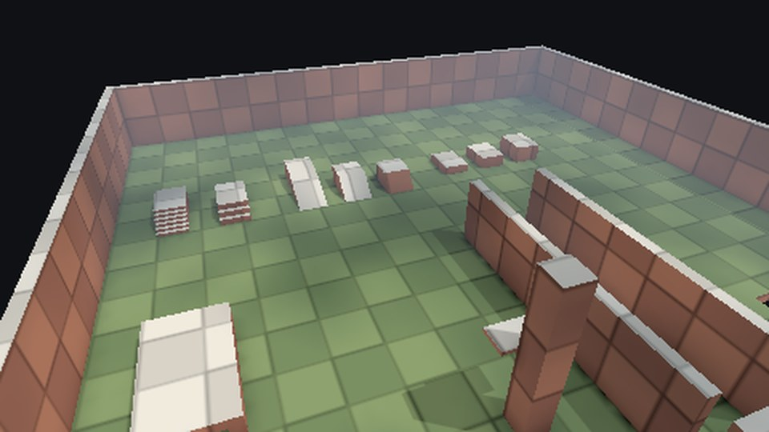
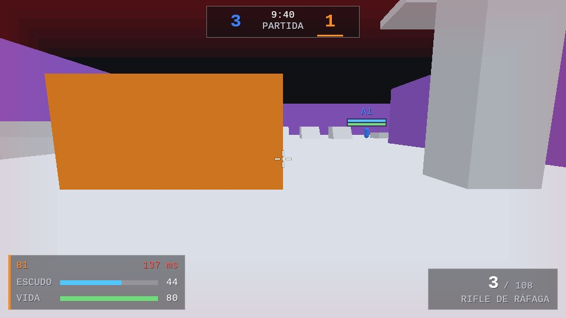

PsyEngine es un motor de juegos que estoy escribiendo de cero en Rust. Arranca por Android y Xbox, y el primer género que soporta es el shooter 3D multijugador. No es un juego publicado: es la base para poder sacar juegos uno detrás de otro sin depender de un motor ajeno.

Tiene una particularidad, que es la razón por la que lo cuento acá: **está diseñado para que una IA escriba el código y pueda verificar su propio trabajo sin mirar la pantalla.**

## El problema

Un motor de juegos es de los programas más difíciles de verificar que conozco. La mitad de los errores no rompen nada: se ven. Un personaje que atraviesa una pared, un disparo que pega donde no debería, una animación que se desfasa con la red. Si la única forma de saber si algo anda es jugar y mirar, cada cambio cuesta minutos de prueba a mano.

Ahora sumale la IA. Ya conté por qué no la dejo decidir: [No dejo que la IA piense. Solo que ejecute](/blog/ia-copiloto). En un motor eso pesa todavía más, porque un error de diseño en la simulación o en la red no se arregla después: se arrastra a todo lo que se construye encima.

Necesitaba dos cosas a la vez: que la IA pudiera avanzar rápido, y que no pudiera avanzar mal sin que algo la frenara.

## La decisión

Tomé las decisiones de diseño antes de que se escribiera el código, y las convertí en reglas que la máquina hace cumplir.

- **Simulación determinista y headless.** El juego corre sin pantalla, tick a tick, y el estado entero se resume en un hash. Mismo input, mismo hash, en x86 y en ARM. Así un test puede correr una partida de cinco minutos y comparar números en vez de mirar imágenes.
- **Un solo comando de verificación.** `cargo xtask check` corre formato, lints estrictos, tests, documentación, la lista de dependencias permitidas, la auditoría de `unsafe` y las capas. Terminar algo significa que eso está en verde; no hay otra definición.
- **Capas que no se pueden saltar.** El motor no sabe nada del shooter. Cada módulo declara su capa (motor, kit de género o juego) y un chequeo rompe el build si alguien la cruza. Un juego de juguete, con cajas que hacen dash, prueba que la frontera sirve para algo que no es un shooter.
- **Casi sin dependencias externas en el runtime.** Cada una necesita una decisión escrita. Me cuesta más trabajo, pero cada pieza del motor la entiendo y la puedo cambiar.

Las decisiones quedan escritas como ADRs: qué se eligió, qué se descartó y por qué. Hoy son 41. La IA escribe el código; las decisiones son mías.

## Cómo lo construí

Lo fui armando por etapas, con un criterio que me ordenó todo: **el juego funciona y se puede testear antes de verse.**

Primero, la simulación del shooter sin gráficos: movimiento con slide, wallrun y gancho, armas definidas como datos, partidas por equipos, bots que juegan como un cliente más y replays que se reproducen verificando hashes.

Después, la red: transporte UDP propio, predicción del jugador, interpolación de los demás, compensación de lag y un simulador de red mala para probar todo eso en tests. La prueba de cierre fue con 8 bots conectados por una red mala simulada durante 5 minutos: el estado de cada cliente coincidió al bit con el del servidor, con unos 5 KB/s por jugador.

Recién ahí, el render: una capa propia sobre Vulkan, ventana propia en la Mac y en Android, texturas comprimidas, luz y sombras con tres niveles de calidad, y animación esquelética con skinning en la GPU. Los tests de render comparan cada imagen contra una de referencia; las dos de acá abajo salen de esos tests.

## El resultado

El teléfono de referencia es un Samsung Galaxy A12, de gama baja, a propósito: si anda ahí, anda en casi cualquier lado. El cierre de la etapa de plataforma fueron 5 minutos de partida en ese teléfono contra un servidor en la Mac por wifi, con 7 bots: **60 cuadros por segundo** sostenidos y sin cortes.

Lo que todavía no existe: un juego publicado, el backend de DirectX 12, el port a Xbox y los servidores en la nube. Hoy todo se prueba en local.

## Stack

Rust · Vulkan (ash) · HLSL → SPIR-V · ECS por arquetipos · Netcode UDP propio · Android (GameActivity) · macOS (AppKit) · Simulación determinista

## Qué me llevo

Que con IA la arquitectura importa más, no menos. Cuando el código lo escribe otro —una persona o un modelo— lo que sostiene la calidad son las decisiones que tomaste antes y las reglas que las hacen cumplir. El motor avanza rápido no porque la IA sea buena decidiendo, sino porque casi no le queda nada por decidir.
