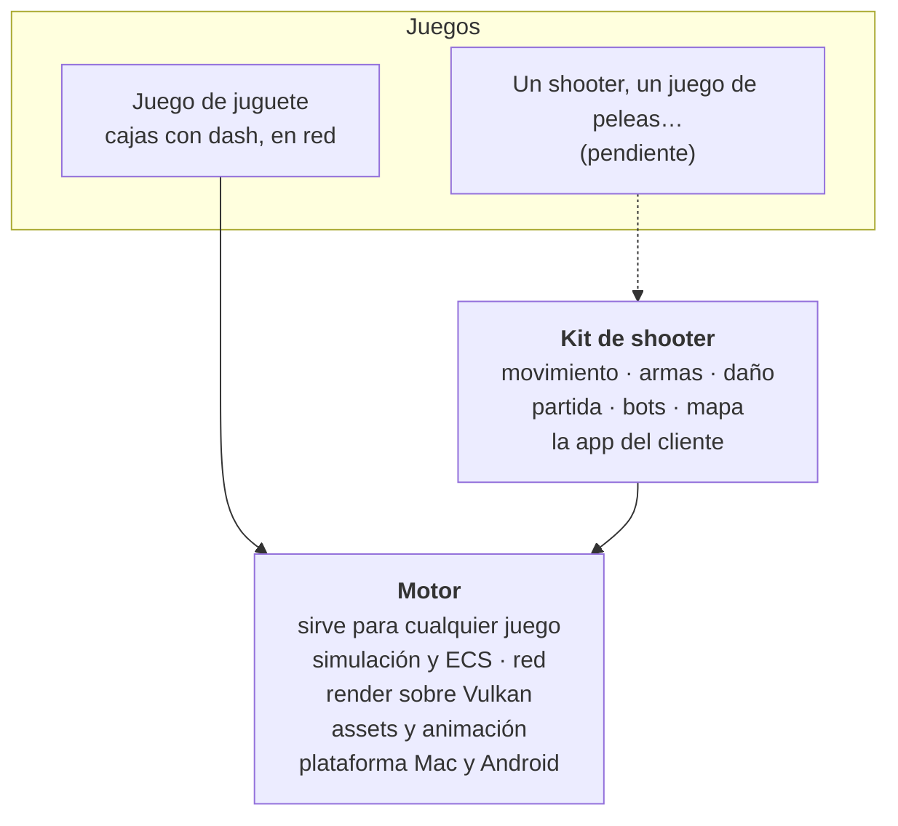
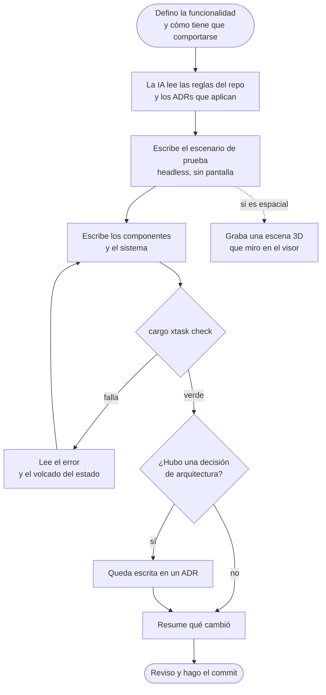
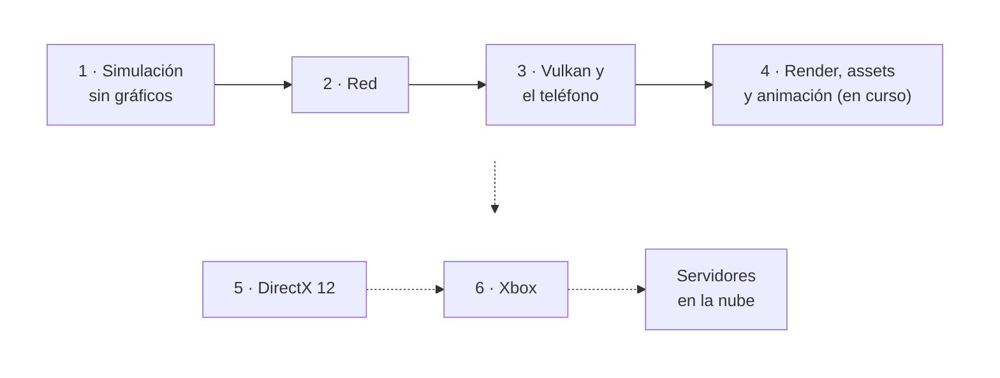
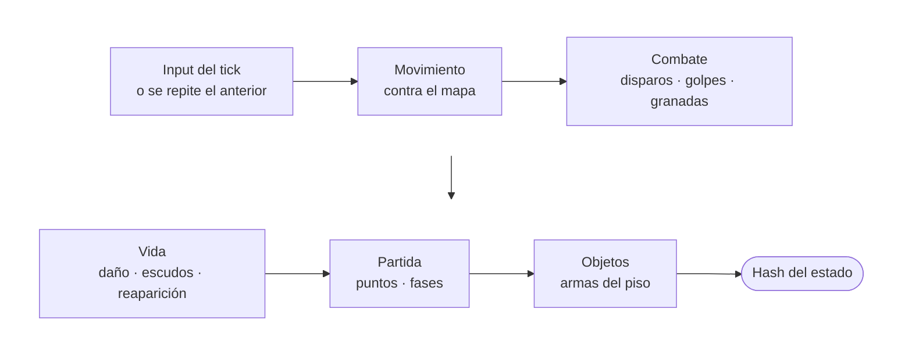
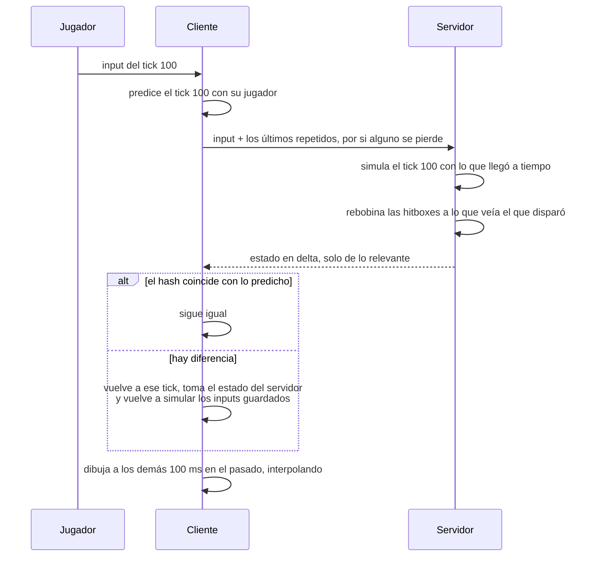
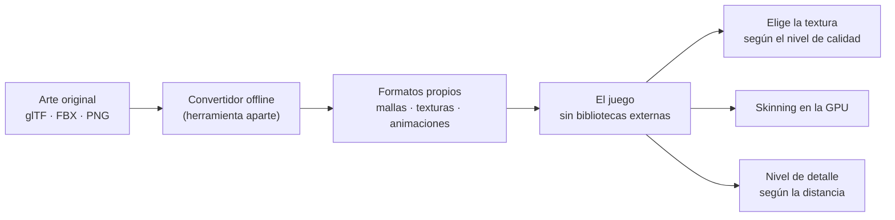
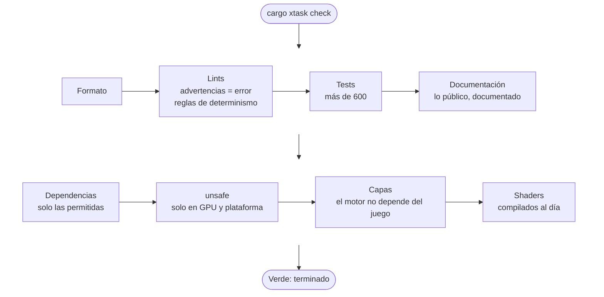

PsyEngine es un motor de juegos que estoy escribiendo de cero en Rust, y en el que vengo trabajando desde principio de año. Arranca por Android y Xbox, y el primer género que soporta es el shooter 3D multijugador. No es un juego publicado: es la base para poder sacar juegos uno detrás de otro sin depender de un motor ajeno.

Tiene una particularidad, que es la razón por la que lo cuento acá: **está diseñado para que una IA escriba el código y pueda verificar su propio trabajo sin mirar la pantalla.**

## El problema

Un motor de juegos es de los programas más difíciles de verificar que conozco. La mitad de los errores no rompen nada: se ven. Un personaje que atraviesa una pared, un disparo que pega donde no debería, una animación que se desfasa con la red. Si la única forma de saber si algo anda es jugar y mirar, cada cambio cuesta minutos de prueba a mano.

Ahora sumale la IA. Ya conté por qué no la dejo decidir: [No dejo que la IA piense. Solo que ejecute](/blog/ia-copiloto). En un motor eso pesa todavía más, porque un error de diseño en la simulación o en la red no se arregla después: se arrastra a todo lo que se construye encima.

Necesitaba dos cosas a la vez: que la IA pudiera avanzar rápido, y que no pudiera avanzar mal sin que algo la frenara.

## La decisión

Tomé las decisiones de diseño antes de que se escribiera el código, y las convertí en reglas que la máquina hace cumplir.

- **Simulación determinista y headless.** El juego corre sin pantalla, tick a tick, y el estado entero se resume en un hash. Mismo input, mismo hash, en x86 y en ARM. Así un test puede correr una partida de cinco minutos y comparar números en vez de mirar imágenes.
- **Un solo comando de verificación.** `cargo xtask check` corre formato, lints estrictos, tests, documentación, la lista de dependencias permitidas, la auditoría de `unsafe`, las capas y los shaders. Terminar algo significa que eso está en verde; no hay otra definición.
- **Capas que no se pueden saltar.** El motor no sabe nada del shooter. Cada módulo declara su capa (motor, kit de género o juego) y un chequeo rompe el build si alguien la cruza. Un juego de juguete, con cajas que hacen dash, prueba que la frontera sirve para algo que no es un shooter.
- **Casi sin dependencias externas en el runtime.** Cada una necesita una decisión escrita. Me cuesta más trabajo, pero cada pieza del motor la entiendo y la puedo cambiar.

Así quedan las capas. Las flechas solo bajan: si alguien hace que el motor dependa del shooter, no compila.

Las decisiones quedan escritas como ADRs: qué se eligió, qué se descartó y por qué. Hoy son 41. La arquitectura, la matemática de la simulación —cómo tiene que comportarse cada fórmula— y las reglas de frontera las diseño yo; la IA escribe el código.

## Cómo trabajo con la IA

Cada funcionalidad sigue el mismo circuito. La IA arranca leyendo las reglas del repo y las decisiones que tocan lo que va a hacer. Después escribe primero el escenario de prueba, sin pantalla, y recién ahí el código. **El que le dice si terminó no soy yo: es el check.** Yo reviso el resumen y hago el commit.

Cuando algo es espacial —una trayectoria, una colisión, el recorrido de un bot— el test graba una escena 3D que abro en un visor en el navegador. Ahí miro para entender, no para verificar.

## Cómo lo construí

Lo fui armando por etapas, con un criterio que me ordenó todo: **el juego funciona y se puede testear antes de verse.**

Primero, la simulación del shooter sin gráficos: movimiento con slide, wallrun y gancho, armas definidas como datos, partidas por equipos, bots que juegan como un cliente más y replays que se reproducen verificando hashes.

Después, la red: transporte UDP propio, predicción del jugador, interpolación de los demás, compensación de lag y un simulador de red mala para probar todo eso en tests. La prueba de cierre fue con 8 bots conectados por una red mala simulada durante 5 minutos: el estado de cada cliente coincidió al bit con el del servidor, con unos 5 KB/s por jugador.

Recién ahí, el render: una capa propia sobre Vulkan, ventana propia en la Mac y en Android, texturas comprimidas, luz y sombras con tres niveles de calidad, y animación esquelética con skinning en la GPU. Los tests de render comparan cada imagen contra una de referencia; las dos de acá abajo salen de esos tests.

## Por dentro

Para quien quiera más detalle, estas son las piezas principales y la decisión detrás de cada una.

### La simulación: un tick, siempre igual

La simulación corre a 60 ticks por segundo, con un paso fijo. No lee el reloj, no toca disco ni red, y no sabe que existe una pantalla. El servidor, los bots, los tests y el cliente corren exactamente la misma simulación.

Cada tick es una secuencia fija de sistemas, siempre en el mismo orden. Un sistema es una función sin estado propio: todo lo que recuerda vive en el mundo, y por eso todo entra en el hash.

En el código de simulación hay cosas prohibidas, y no por convención: los lints las bloquean. No hay mapas con orden de iteración aleatorio, no hay reloj del sistema, no hay números aleatorios que no salgan de un generador con semilla.

### Determinismo entre procesadores

Mismo input, mismo estado, bit a bit, en x86 (donde va a correr el servidor) y en ARM (donde corren los teléfonos). No es un capricho: si el cliente predice su movimiento con una simulación que da un bit distinto que la del servidor, se separan en cada tick.

Un detalle muestra hasta dónde llega eso. El seno y el coseno de la biblioteca estándar dependen del sistema operativo y pueden diferir en el último bit. Por eso **la trigonometría del motor es propia**: reduce el ángulo a un rango chico y evalúa un polinomio usando solo sumas, restas y multiplicaciones, que el estándar IEEE 754 garantiza iguales en cualquier procesador. El error queda por debajo de 2 diezmillonésimas, y un test fija la huella bit a bit de 100.000 resultados: si en alguna plataforma da distinto, falla. La integración continua corre en las dos arquitecturas.

### Un estado que se guarda y se restaura

Todo el estado del juego vive en un ECS por arquetipos: cada combinación de componentes tiene su propia tabla, con una columna contigua en memoria por componente. Recorrer cientos de proyectiles es leer memoria en orden, que es lo que mejor hace un procesador de teléfono.

Además, cada componente sabe convertirse a bytes con un formato fijo (little-endian, sin tipos que cambien de tamaño según la plataforma), y el lector nunca se cae ante datos rotos: valida cada largo antes de leer. Con eso, el mundo entero se guarda en un tick y se restaura después. **Esa sola pieza sostiene tres cosas**: la reconciliación de la red, los replays y los bots.

### El shooter, como datos

Sobre el motor está el kit de shooter, con un disparo inspirado en el de Halo y mucha movilidad, para partidas de 2 a 12 jugadores:

- **Movimiento:** choque y deslizamiento contra el mapa, escalones, pendientes, salto con margen después de pisar el borde (*coyote time*) y salto anticipado, más slide, doble salto, wallrun, trepar, dash y gancho, organizados como una máquina de estados.
- **Armas:** hitscan y proyectiles con comportamientos (arco, rebote, pegajoso, persecución, cadena), asistencia de apuntado y hitboxes por zona con historial. Las ocho armas están definidas como datos, con duraciones en ticks y su balance verificado en tests.
- **Bots:** juegan como un cliente más, sin acceso privilegiado. Navegan un grafo del mapa con A* (caminando, agachados, saltando, trepando, por la pared o con el gancho), apuntan con tiempo de reacción y error, y tienen tres dificultades.
- **Replays:** guardan el mapa entero y los inputs solo cuando cambian, con un hash cada tantos ticks. Al reproducir, si algo diverge, se detecta en el tick exacto.

La prueba de cierre de esta etapa fue una partida de 5 minutos con bots, sin nadie atravesando paredes, determinista tick a tick y reproducible desde su replay. Con 12 jugadores y unos 200 proyectiles en el aire, el 99 % de los ticks tarda menos de 0,35 ms, contra un presupuesto de 1 ms.

### Red

Servidor autoritativo y transporte UDP propio, con mensajes confiables y no confiables. El cliente predice solo a su propio jugador, con la misma simulación que el servidor. Como el estado propio llega exacto, comparar el hash detecta una desincronización en el momento.

- **Compensación de lag:** para los disparos instantáneos y los golpes, el servidor rebobina las hitboxes hasta lo que veía el que disparó, con pings de hasta 200 ms.
- **Ancho de banda:** el estado va en delta contra lo último confirmado y **lo que un jugador no puede ver no se le manda**. Eso ahorra bytes y también sirve contra el wallhack, porque no se puede mostrar lo que nunca llegó. Con 12 bots, unos 6 KB/s por jugador, contra un presupuesto de 15.
- **Seguridad local:** el servidor valida contra el ping que mide él lo que el cliente dice sobre su latencia, y descarta por la cabecera los paquetes que no son suyos, sin decodificarlos. Un millón de paquetes basura no cambian la partida.

Todo esto se prueba con un simulador de red mala (latencia, variación, pérdida, duplicados, desorden) que es determinista, así que una falla de red se puede reproducir en un test.

### Render

Una capa propia de render (RHI) con despacho estático: cada plataforma compila un solo backend y no paga indirección. Hoy está el de Vulkan (Android y la Mac, a través de MoltenVK) y uno nulo para tests y para el servidor. El de DirectX 12, para Xbox y Windows, es la etapa 5.

Los shaders se escriben en HLSL y se compilan a SPIR-V dentro del repo. El render es *forward* porque las GPUs de teléfono dibujan la pantalla por partes, y el *deferred* les sale caro.

Hay **tres niveles de calidad con el mismo contenido**:

- **Bajo** (el A12): sol y luz ambiente, oclusión horneada en los vértices del mapa, la sombra de los jugadores como una mancha y texturas en ASTC 8×8.
- **Medio:** lo anterior calculado por píxel, un mapa de sombras chico y niebla.
- **Alto** (Mac, Xbox): materiales más realistas, mejores sombras y más luces.

El motor elige el nivel según la GPU al arrancar y lo baja solo si el tiempo de cuadro se pasa varios segundos seguidos. Los tests de render corren en Vulkan por software y comparan cada imagen contra una de referencia; un error de las capas de validación hace fallar el test.

### Assets y animación

El arte se convierte offline a formatos binarios propios. La herramienta que convierte puede usar bibliotecas externas; el juego, no. Los formatos comparten un contenedor con suma de control y un lector que nunca se cae, y cada textura trae todas sus versiones comprimidas para que el juego cargue la que le toca. En el A12, **los personajes pasaron de ocupar 88 MB de memoria de GPU a 2,5 MB**, y cargan en menos de 300 ms.

La animación es esquelética y determinista. Cada personaje tiene 65 huesos y unos 10.000 vértices; moverlos en la CPU con 12 jugadores eran unos 120.000 vértices por cuadro, demasiado para el teléfono. Por eso el skinning corre en la GPU, con las poses guardadas en una textura: es lo que hasta una GPU vieja lee rápido desde el shader de vértices.

Eso bajó el A12 de 60 a unos 42 cuadros por segundo. La respuesta fueron los niveles de detalle: el convertidor arma tres versiones más simples de cada malla (la mitad, un cuarto y un décimo de los triángulos) y el render elige según el error que se vería en pantalla, en píxeles. Un personaje de 12.566 triángulos baja a 1.256 cuando está lejos, sin que se note.

Las hitboxes también pueden seguir los huesos de la animación real, y el reloj de la animación viaja por la red, así el cliente anima a cada jugador con el mismo reloj que usa el servidor para sus hitboxes.

### El harness

`cargo xtask check` es la definición de terminado. Si cualquier paso falla, el cambio no está terminado, lo haya escrito yo o la IA.

Un par de reglas que no se ven en el diagrama: nada de `unwrap()` en el código del motor, y cada hito terminado lleva un documento escrito para alguien que no conoce el tema (qué es, por qué hace falta, cómo funciona, cómo se prueba). La documentación es parte del trabajo, no un extra.

## El resultado

El teléfono de referencia es un Samsung Galaxy A12, de gama baja, a propósito: si anda ahí, anda en casi cualquier lado. El cierre de la etapa de plataforma fueron 5 minutos de partida en ese teléfono contra un servidor en la Mac por wifi, con 7 bots:

- **60 cuadros por segundo** sostenidos, con el 99 % de los cuadros por debajo de 19,8 ms;
- temperatura normal al minuto 5;
- ping de 21 a 51 ms y unos 4,8 KB/s de bajada.

También se probó con la Mac, el A12 y un Redmi 14C jugando a la vez.

Lo que todavía no existe: un juego publicado, el backend de DirectX 12, el port a Xbox y los servidores en la nube. Hoy todo se prueba en local.

## Stack

Rust · Vulkan (ash) · HLSL → SPIR-V · ECS por arquetipos · Netcode UDP propio · Android (GameActivity) · macOS (AppKit) · Simulación determinista

## Qué me llevo

Que con IA la arquitectura importa más, no menos. Cuando el código lo escribe otro —una persona o un modelo— lo que sostiene la calidad son las decisiones que tomaste antes y las reglas que las hacen cumplir. El motor avanza rápido no porque la IA sea buena decidiendo, sino porque casi no le queda nada por decidir.
